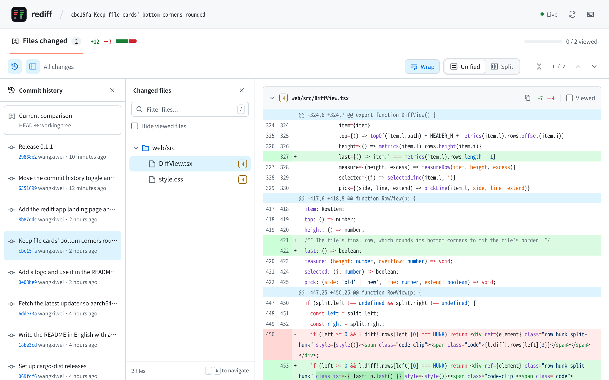

<p align="center">
  
</p>

<h1 align="center">rediff</h1>

<p align="center"><strong>重新设计的 diff 审阅方式。</strong></p>

<p align="center"><a href="README.md">English</a> | 简体中文</p>

在浏览器里查看 git diff 的命令行工具。单个 Rust 二进制，前端资源编译进二进制里，启动后自动打开浏览器。

```sh
rediff                      # 工作区 vs HEAD（包含未跟踪文件）
rediff --cached             # 暂存区 vs HEAD
rediff main                 # 工作区 vs main
rediff main feature         # main vs feature
rediff HEAD~3..HEAD -- src  # 提交区间，限定路径
rediff --help               # 全部选项：-U、--algorithm、--host、--port、--no-open、--no-watch ...
```

<picture>
  <source media="(prefers-color-scheme: dark)" srcset="assets/screenshot-dark.png">
  
</picture>

页面参考 GitHub 的 Files changed 布局：左侧是可筛选的文件树，右侧按文件显示 diff。工具栏左侧的历史按钮打开当前分支的提交列表（每次加载 100 个，可继续加载更多）。点一个提交查看它的改动（相对第一个父提交，根提交相对空树）；最上面一项回到命令行指定的 diff。给了路径参数时，列表只显示改过这些路径的提交。

- **对比视图**：Unified / Split 切换统一或双栏 diff，记住上次选择。默认开启 Wrap，长行按代码区宽度自动换行，双栏两侧仍保持行对齐。关闭 Wrap 后，使用底部横向滚动条、触控板横滑或 Shift + 滚轮查看完整代码（双栏同步滚动），文件标题和行号固定；换行偏好会保存。
- **文件导航**：按路径筛选（也匹配重命名前的路径），工具栏支持上一个 / 下一个文件、全部折叠 / 展开；窄屏下文件树和提交列表以浮动面板打开。
- **审阅进度**：勾选 Viewed 自动折叠文件，Hide viewed files 隐藏已读文件。标记按比较对象和文件版本记录在当前页面会话中，文件内容变化后自动取消，刷新页面会清空。
- **行与路径**：点击行号高亮一行，Shift + 点击选择同行侧的连续范围；文件标题旁可复制完整路径。
- **快捷键**：`j` / `k` 切换文件，`/` 筛选，`v` 标记已读，`c` 折叠 / 展开，`?` 查看帮助。输入框内不会触发导航快捷键。

启动后会打印两个地址：本机地址（`local`）和局域网地址（`network`，取默认路由所在网卡的 IP），在远程开发机上运行时可以直接在自己电脑的浏览器里打开 `network` 那个。URL 里带一次性 token，没有它无法读取 API。只想本机访问时加 `--host 127.0.0.1`。

注意局域网访问走的是明文 HTTP：同一网络里能抓包的人可以看到 token 和 diff 内容，在不信任的网络里请用 `--host 127.0.0.1` 加 SSH 端口转发。

## 安装

macOS / Linux：

```sh
curl --proto '=https' --tlsv1.2 -LsSf https://github.com/rediff-app/rediff/releases/latest/download/rediff-installer.sh | sh
```

Windows（PowerShell）：

```powershell
powershell -ExecutionPolicy Bypass -c "irm https://github.com/rediff-app/rediff/releases/latest/download/rediff-installer.ps1 | iex"
```

安装到 `~/.cargo/bin`，同时装上 `rediff-update`，之后运行它即可升级到最新版本。也可以从 [Releases](https://github.com/rediff-app/rediff/releases) 页面直接下载对应平台的压缩包。

## 构建

依赖：Rust（stable）、Node.js 20+、git。

```sh
make build        # 构建前端 + release 二进制 -> target/release/rediff
make install      # 安装到 ~/.cargo/bin
make test         # Rust 单测 + 前端类型检查与布局单测
```

## 开发

两种方式：

1. **前端改动频繁**：`make dev-web`（vite build --watch）+ `cargo run -- <参数>`。debug 构建运行时直接从磁盘读 `web/dist`，前端改完刷新页面即可，不需要重新编译 Rust。
2. **需要 HMR**：`cargo run -- --port 7777 --no-open` + `cd web && npm run dev`，然后把终端里的 URL 换成 `http://localhost:5173/auth?token=...` 打开。Vite 会把 `/api` 和 `/auth` 代理到 7777 端口。

## 结构

```
src/
  main.rs     命令行参数、启动服务器、打开浏览器
  git.rs      调用 git 命令：文件列表（--raw --numstat -z）、单文件 patch、未跟踪文件、提交列表
  patch.rs    把 patch 解析成紧凑的行数组 + 行内（词级）diff
  server.rs   axum 路由、token 鉴权、diff 缓存、各提交的文件列表缓存、SSE 推送
  watch.rs    监听工作区 / index / refs，变化后推给前端
  assets.rs   rust-embed 内嵌的前端资源
web/src/
  store.ts          文件列表、按需加载 diff 的队列、折叠状态、当前选中的提交
  Commits.tsx       提交列表（最左侧一栏）
  Sidebar.tsx       目录树侧边栏（单子目录链压缩显示，目录可折叠）
  tree.ts           树的排序与构建：每层目录在前、自然排序；diff 区用同一顺序
  DiffView.tsx      两级虚拟滚动（文件 + 行）
  diffRows.ts       双栏行对齐与横向滚动宽度估计
  rowLayout.ts      可变行高索引，支持换行后的虚拟滚动
  render.ts         语法 token 与词级 diff 合并成一行 HTML
  highlight*.ts     Web Worker 里跑 shiki，语言按需懒加载
```

## 性能相关的设计

- **git 层用 git 命令而不是 libgit2**：大仓库上 status/diff 更快（fsmonitor、untracked cache），`.gitattributes`、重命名检测等行为和 git 一致。设置了 `GIT_OPTIONAL_LOCKS=0`，后台运行时不会改写 index。
- **diff 算法默认跟随仓库的 `diff.algorithm`**（没配置就用 myers），和 `git diff` 显示的一致。不强制用 histogram，因为老版本 git 的 histogram 在某些输入上会严重退化：git 2.20 上一个 20 万行、隔行修改的文件，myers 只要 0.14 秒，histogram 30 秒都跑不完。单文件 diff 设了 60 秒超时作为兜底。
- **按需加载**：首屏只请求文件列表；滚动到哪个文件才请求哪个文件的 diff，同时最多 4 个请求，优先加载可见区域。超大文件、lockfile 默认折叠。
- **内容寻址缓存**：每个文件有一个 `version`（两侧都是 git 对象时就是 oid 对，工作区文件用 mtime+size）。服务端按 `path + version` 做 LRU 缓存（上限 128 MB）；两侧都是对象时响应带 `Cache-Control: immutable`，工作区文件用 ETag 返回 304。
- **紧凑的数据格式**：每行是 `[kind, old, new, text, inline?]` 数组而不是对象，再做 gzip/br/zstd 压缩（只用快速档位）。
- **前端只渲染可见的行**：DOM 节点按行对象复用；换行后的高度先估计，再根据可见代码的实际高度校正，通过可变行高索引定位视口，单行高度更新和定位都是 O(log n)。切换换行、视图或调整窗口宽度时按代码行锚定位置；大量行的 diff 也只渲染视口附近的行。
- **语法高亮不占主线程**：shiki 用 JS 正则引擎（不需要 wasm），在 Worker 里按文件整段高亮，结果以 class 形式输出，合并后用一次 innerHTML 写入。
- **实时刷新**：Linux 上只对没被 ignore 的目录逐个加 inotify watch（避免 `node_modules`、`target` 耗尽 watch 配额），事件去抖后通过 SSE 推送；前端只重新拉取 version 变了的文件。

## 实测（505 个文件，其中一个文件改了 20 万行）

| 项目 | 结果 |
|---|---|
| 文件列表 `/api/files`（命中缓存） | < 1 ms |
| 20 万行改动的文件（30 万行，9.1 MB JSON），首次请求 | 288 ms |
| 同一文件再次请求（服务端缓存） | 2.7 ms |
| 同一文件 zstd 压缩后 | 417 KB，28 ms |
| 打开页面到首批行出现（headless Chromium） | ≈ 130 ms |
| 在这个文件里每帧滚动 1500px，共 200 次 | 每帧中位数 16.5 ms（被 60Hz 刷新率卡住），DOM 最多 123 行 |
| 改文件到页面显示新内容 | ≈ 330 ms |

## 已知限制

- 浏览器对元素高度有上限（Chrome 约 3300 万 px），所有展开文件加起来超过约 150 万个显示行时，最后面的内容无法滚动到；自动换行会增加显示行数。
- 行是虚拟渲染的，跨越很多屏的文本选区会在滚动后丢失。
- 语法高亮按 hunk 拼接后整体分词，hunk 恰好从多行注释或字符串中间开始时，开头几行的颜色可能不对。
